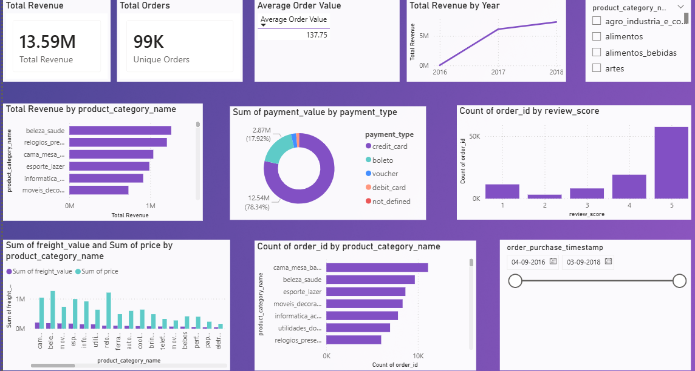
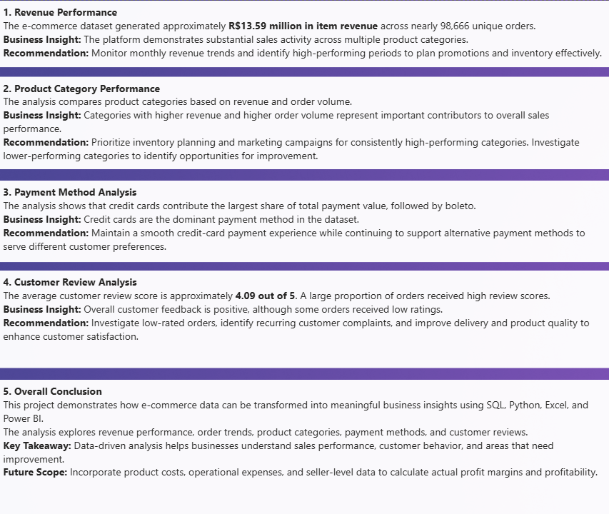

# E-Commerce Business Intelligence & Profitability Analysis

## Project Overview
This project focuses on analyzing Brazilian e-commerce data to understand sales performance, customer behavior, product category performance, payment methods, and customer reviews.

The objective is to transform raw e-commerce data into meaningful business insights using Python, SQL, and Power BI.

## Tools & Technologies
- Python
- Pandas
- NumPy
- SQL
- Power BI
- Excel

## Dataset
The project uses the Brazilian Olist E-Commerce dataset.

The dataset includes:
- Customer orders
- Order items and product prices
- Freight values
- Payment information
- Customer reviews
- Product categories

## Project Workflow
1. Data loading and inspection
2. Data cleaning and preprocessing using Python
3. Data storage and analysis using SQL
4. KPI calculation and business analysis
5. Interactive dashboard development using Power BI
6. Business insights and recommendations

## Key Business Metrics
- Total Item Revenue
- Unique Orders
- Average Order Value
- Monthly Revenue Trends
- Revenue by Product Category
- Payment Method Distribution
- Customer Review Analysis
- Freight Value Analysis

## Key Findings
- Total item revenue is approximately R$13.59 million.
- The dataset contains approximately 98,666 unique orders.
- Credit cards contribute the largest share of payment value.
- The average customer review score is approximately 4.09 out of 5.
- Product categories show different revenue and order-volume patterns.

## Power BI Dashboard Features
- KPI cards for revenue, orders, and average order value
- Monthly revenue trend analysis
- Revenue by product category
- Payment method distribution
- Customer review score analysis
- Order volume by product category
- Revenue versus freight comparison
- Interactive date and product category slicers
- Business insights and recommendations

## Dashboard Preview

### E-Commerce Sales & Performance Dashboard

### Business Insights

## Important Note
Actual profit cannot be calculated from the available dataset because complete product costs and operating expenses are not available.

Therefore, this project focuses on revenue and business performance analysis rather than claiming actual net profit.

## Future Improvements
- Include product and operational cost data.
- Calculate actual profit margins when cost data becomes available.
- Perform customer segmentation.
- Develop sales forecasting models.
- Add advanced dashboard interactivity.

## Author
**Srushti Shreedhar Muddi**

Artificial Intelligence & Data Science Graduate

GitHub: [SrushtiMuddi9](https://github.com/SrushtiMuddi9)
LinkedIn: [Srushti M](https://www.linkedin.com/in/srushti-m-4a3bb7358)

